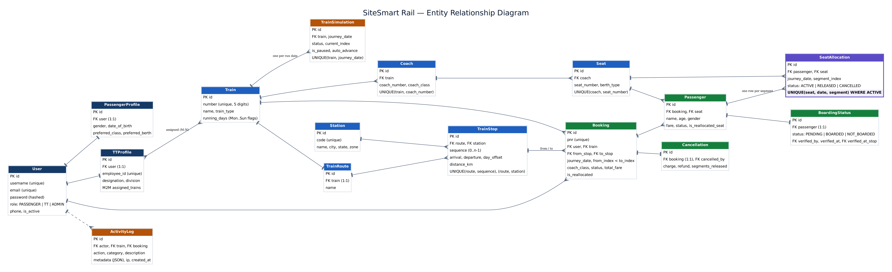

# SiteSmart Rail — Railway Vacant Seat Reallocation System

A full-stack Django application that puts **verified no-show seats back into service**.
When a passenger with a confirmed reservation does not board, the Travelling Ticket
Examiner (TT/TTE) marks them as *Did not board*, and the seat's remaining journey
segments immediately become bookable for passengers joining at upcoming stations —
without ever double-booking a berth.

> **Academic simulation.** Train movement and TT verification are simulated. This
> project is not affiliated with Indian Railways or IRCTC, does not use any real
> railway API, and its tickets are not valid for travel. All people, train numbers and
> train names in the demo data are fictional.

Full Stack Development Lab project — Jaypee Institute of Information Technology.

---

## Contents

1. [Problem statement](#1-problem-statement)
2. [Features](#2-features)
3. [Technology stack](#3-technology-stack)
4. [Architecture](#4-architecture)
5. [Folder structure](#5-folder-structure)
6. [Database design](#6-database-design)
7. [The seat reallocation algorithm](#7-the-seat-reallocation-algorithm)
8. [Installation](#8-installation)
9. [Environment configuration](#9-environment-configuration)
10. [Migrations and demo data](#10-migrations-and-demo-data)
11. [Running the project](#11-running-the-project)
12. [Demo login credentials](#12-demo-login-credentials)
13. [Demonstrating the no-show scenario](#13-demonstrating-the-no-show-scenario)
14. [Running the tests](#14-running-the-tests)
15. [Known limitations](#15-known-limitations)
16. [Future scope](#16-future-scope)

More detail lives in [`docs/`](docs): [algorithm](docs/ALGORITHM.md),
[database schema](docs/DATABASE_SCHEMA.md), [REST API](docs/API.md),
[demo script](docs/DEMO_GUIDE.md), [testing](docs/TESTING.md) and the
[ER](docs/diagrams/er_diagram.png) and [workflow](docs/diagrams/system_workflow.png) diagrams.

---

## 1. Problem statement

A train runs `A → B → C → D → E`. A passenger books seat 25 from A to E but never
turns up at A. In a conventional system the seat travels empty all the way to E,
because a seat is treated as simply *occupied* or *free* for the whole journey.

Seat availability actually depends on **which stretches of track** a booking covers
and **where the train currently is**. This project tracks every seat per
station-to-station segment, lets the TT verify boarding, and releases the remaining
segments of a no-show's seat so that, for example:

| Passenger | Journey | Result |
|-----------|---------|--------|
| P1 | A → E | Did not board (verified by TT at A) |
| P2 | B → C | ✅ allowed on seat 25 |
| P3 | C → D | ✅ allowed on seat 25 (only *touches* P2 at C) |
| P4 | B → D | ❌ rejected if P2/P3 hold B→C / C→D |
| P5 | C → E | ❌ rejected — overlaps C → D |

## 2. Features

**Passenger portal**
- Registration, sign-in (username *or* e-mail), profile and password management
- Train search by station, date, class and passenger count, with per-class
  availability calculated for the exact segment range and the train's live position
- 8-step booking flow: search → train → class & coach → seat map → passenger details
  → review → confirm → PNR & e-ticket
- Interactive coach seat map (berth and chair-car layouts) with *released* seats
  highlighted, and **best-fit auto-pick**
- 10-digit PNR, booking confirmation, QR-coded e-ticket (signed, tamper-evident),
  downloadable **PDF ticket** (ReportLab) and print view
- Booking history with tabs (upcoming / completed / cancelled), live train position,
  boarding status, cancellation with simulated refund, public PNR-status page

**TT / TTE portal**
- Dashboard of assigned trains with verification progress and a Chart.js summary
- **Run console**: start, step, *move to next station*, pause/resume and auto-run the
  simulated train; live station tracker and progress
- Passenger list with filters (coach, status, *boarding here*, *on route now*) and PNR/name search
- **Mark Boarded / Did not board** with a confirmation dialog and remarks; a boarded
  passenger can never be released afterwards
- Coach occupancy per segment and a **released seats** panel listing the journeys each
  released seat can still serve (with a link straight to that search)
- PNR / ticket lookup restricted to assigned trains

**Administrator portal** (plus Django Admin as a secondary interface)
- Dashboard: trains, stations, passengers, bookings, active TT accounts, released seats,
  seat utilisation, recent activity — with four Chart.js charts, all from the database
- Trains (add / edit / delete), route editor (add, reorder, remove stops; timings,
  day offsets, distances), coaches with automatic berth layouts, seat management
- Stations, schedules (running days), passengers (activate / deactivate),
  TT accounts with train assignment
- All bookings with filters, cancellation records, boarding verification monitor,
  released seats per run, train simulation for every train
- **Seat allocation monitor**: a seat × segment heat-map for any run, plus a *what-if*
  checker that explains whether a seat could take a given journey and why not
- System activity log (sign-ins, bookings, verifications, releases, reallocations,
  train movements, admin changes)

**Engineering**
- Segment-level allocation engine in small, documented service functions
- Triple protection against double booking: IMMEDIATE-mode SQLite transactions,
  `select_for_update`, and a **partial unique index** in the database
- REST API (Django REST Framework) used by every interactive screen
- Role-based access on every view and endpoint, CSRF on all writes, environment-based config
- 93 automated tests, including a multi-threaded race test
- Responsive UI (desktop → mobile), toasts, confirmation modals, skeleton loaders,
  empty and error states, offline-capable (all CSS/JS/fonts are vendored)

## 3. Technology stack

| Layer | Technology |
|-------|------------|
| Backend | Python 3.10+, Django 5.1, Django REST Framework, Django authentication & ORM |
| Database | SQLite (default) via Django ORM |
| Frontend | HTML5, CSS3, Bootstrap 5.3, vanilla JavaScript (Fetch API), Chart.js 4, Bootstrap Icons |
| Documents | ReportLab (PDF tickets), qrcode + Pillow (QR codes) |
| Config | python-dotenv, environment variables |

Bootstrap, Bootstrap Icons, Chart.js and the Inter / JetBrains Mono fonts are vendored
under `static/vendor/`, so the app works without internet access during a presentation.

## 4. Architecture

```
Browser (Bootstrap + JS) ──HTML pages──▶ Django views (templates)
        │                                     │
        └──fetch() JSON──▶ DRF API views ─────┤
                                              ▼
                            Service layer (apps/bookings/services, apps/operations/services)
                            availability · reservation · release · boarding · cancellation · simulation
                                              │
                                              ▼
                                Django ORM models  ──▶  SQLite
```

- **Views stay thin**: they parse input, check roles, call a service and render.
- **Services own the business rules** and every state change runs in one transaction.
- **The API and the HTML pages share the same services**, so behaviour is identical
  whichever way an action is triggered.

See the [system workflow diagram](docs/diagrams/system_workflow.png).

## 5. Folder structure

```
SiteSmart_Railway_Seat_Reallocation_System/
├── manage.py
├── requirements.txt · .env.example · .gitignore · setup.sh · setup.bat
├── config/                  Django project: settings, urls, wsgi, asgi
├── apps/
│   ├── core/                landing page, permissions, form mixin, template tags,
│   │   └── management/commands/   seed_demo.py, run_demo_scenario.py
│   ├── accounts/            User (custom), PassengerProfile, TTProfile, auth views & forms
│   ├── railway/             Station, Train, TrainRoute, TrainStop, Coach, Seat; train search
│   ├── bookings/            Booking, Passenger, SeatAllocation, BoardingStatus, Cancellation
│   │   └── services/        segments, availability, reservation, release, boarding,
│   │                        cancellation, fares, pnr, tickets (QR + PDF), status
│   ├── operations/          TrainSimulation, ActivityLog; TT views
│   │   └── services/        simulation.py, activity.py
│   ├── adminpanel/          custom administrator portal (views, forms, analytics services)
│   └── api/                 DRF endpoints, serializers, permissions, error handler
│   (each app has a tests/ package)
├── templates/               layouts/, partials/, core/, accounts/, railway/, bookings/,
│                            tt/, adminpanel/, errors/
├── static/
│   ├── css/app.css          design system
│   ├── js/                  app.js, booking.js, tt-console.js, allocation.js, charts.js
│   ├── img/                 logo, favicon
│   └── vendor/              Bootstrap, Bootstrap Icons, Chart.js, fonts
└── docs/                    ALGORITHM, DATABASE_SCHEMA, API, DEMO_GUIDE, TESTING, diagrams/
```

## 6. Database design

Sixteen models (full field list in [docs/DATABASE_SCHEMA.md](docs/DATABASE_SCHEMA.md)):

`User` · `PassengerProfile` · `TTProfile` · `Station` · `Train` · `TrainRoute` ·
`TrainStop` · `Coach` · `Seat` · `Booking` · `Passenger` · `SeatAllocation` ·
`BoardingStatus` · `TrainSimulation` · `Cancellation` · `ActivityLog`



The key design decision: **`SeatAllocation` stores one row per seat, run date and
segment.** A passenger travelling from stop 1 to stop 4 owns three rows (segments 1, 2,
3). The partial unique constraint

```python
UniqueConstraint(fields=["seat", "journey_date", "segment_index"],
                 condition=Q(status="ACTIVE"), name="uniq_active_seat_segment")
```

means the database itself refuses a second ACTIVE occupant for any segment. Released
(no-show) and cancelled rows stay as an audit trail but no longer block anyone.

## 7. The seat reallocation algorithm

Full explanation with worked examples: [docs/ALGORITHM.md](docs/ALGORITHM.md).

**Segments.** Stops are indexed `0 … n-1`; segment `i` runs from stop `i` to stop `i+1`.
A journey `s → d` occupies the half-open interval `[s, d)`. Two journeys conflict iff

```
s1 < d2  and  s2 < d1
```

so `B→C [1,2)` and `C→D [2,3)` share a seat, while `B→D [1,3)` and `C→E [2,4)` collide on segment 2.

**Availability** of a seat for `[s, d)` on a date requires both:

1. *Occupancy* — no ACTIVE `SeatAllocation` for that seat/date on any segment in `[s, d)`.
2. *Train position* — `s ≥ min_boardable_index` from the run's `TrainSimulation`
   (0 before departure, `k` while halted at stop `k`, `k+1` once it has left `k`).
   Departed segments are therefore never sold again, even if a no-show left them empty.

**Reserving** (`reservation.reserve_seats`) — inside one IMMEDIATE transaction:
validate the journey → lock the chosen seats → **re-check occupancy and position** →
write `Booking`, `Passenger`, `BoardingStatus` and one `SeatAllocation` per segment.
If a concurrent request slipped through, the unique index raises `IntegrityError`,
which is turned into a friendly "seat just taken" error and the whole booking rolls back.

**No-show** (`boarding.process_no_show`) — only after the train has reached the
passenger's boarding station, only if they are still *Pending*, and only by a TT
assigned to the train (or an admin): set `NOT_BOARDED`, then
`release_seat_segments()` flips the passenger's ACTIVE rows to `RELEASED`. The seat is
instantly offered for every remaining segment ahead of the train.

**Best-fit selection** (`availability.find_eligible_seats`) — when the passenger uses
*Auto-pick*, seats are ranked by how many free segments the booking would leave
stranded around it. A released gap that exactly matches the journey scores 0 and is
filled first, keeping long empty runs on other seats free for long journeys.

| Responsibility | Function |
|----------------|----------|
| Check seat availability | `availability.check_seat_availability`, `is_seat_available`, `get_available_seats` |
| Reserve a seat | `reservation.reserve_seats` |
| Release seat segments | `release.release_seat_segments` |
| Process no-shows | `boarding.process_no_show` (and `mark_passenger_boarded`) |
| Process cancellations | `cancellation.cancel_booking` |
| Simulate station movement | `operations/services/simulation.advance_simulation` |
| Find eligible seats for an upcoming journey | `availability.find_eligible_seats`, `released_seats_report` |

## 8. Installation

Requirements: **Python 3.10 or newer** (tested with 3.13) and `pip`. No internet
connection is needed at runtime.

**Quick setup (does steps 1–5 below):**

```bash
# macOS / Linux
./setup.sh
# Windows
setup.bat
```

**Manual setup:**

```bash
# 1. Unzip and enter the folder
cd SiteSmart_Railway_Seat_Reallocation_System

# 2. Create and activate a virtual environment
python -m venv venv
source venv/bin/activate          # Windows: venv\Scripts\activate

# 3. Install dependencies
pip install -r requirements.txt

# 4. Create your .env file
cp .env.example .env               # Windows: copy .env.example .env
#    then set DJANGO_SECRET_KEY (see section 9)

# 5. Create the database and load demo data
python manage.py migrate
python manage.py seed_demo
```

## 9. Environment configuration

All settings come from environment variables, optionally loaded from `.env`
(see [`.env.example`](.env.example)).

| Variable | Default | Purpose |
|----------|---------|---------|
| `DJANGO_SECRET_KEY` | random per run in debug | **Set this.** Required when `DJANGO_DEBUG=False`. |
| `DJANGO_DEBUG` | `True` | Debug mode; also enables the demo-account buttons on the sign-in page |
| `DJANGO_ALLOWED_HOSTS` | `localhost,127.0.0.1,[::1]` | Comma-separated host names |
| `DJANGO_CSRF_TRUSTED_ORIGINS` | *(empty)* | Needed only behind a custom domain |
| `DJANGO_TIME_ZONE` | `Asia/Kolkata` | Server time zone |
| `DJANGO_SECURE_COOKIES` | `not DEBUG` | Secure session/CSRF cookies (HTTPS) |
| `SQLITE_PATH` | `db.sqlite3` | Database file name |
| `ADVANCE_BOOKING_DAYS` | `120` | Reservation window |
| `SIMULATION_DEFAULT_INTERVAL` | `20` | Seconds between auto-run steps |
| `DEMO_PASSWORD` | `Demo@12345` | Password given to fictional demo accounts by `seed_demo` |

Generate a secret key with:

```bash
python -c "from django.core.management.utils import get_random_secret_key as g; print(g())"
```

## 10. Migrations and demo data

```bash
python manage.py migrate            # create / upgrade the database schema
python manage.py seed_demo          # load demo data (refuses if data already exists)
python manage.py seed_demo --reset  # wipe EVERYTHING and reload fresh demo data
```

The seed creates 29 stations, 7 trains with realistic routes and coach layouts
(~1,570 seats), fictional users, around 1,500 bookings (past completed runs with TT
verification, no-shows and reallocations; upcoming bookings; some cancellations) and
the staged demo run. Every seeded booking goes through the real allocation engine.

> The demonstration run is **today's** run of train 24051. Run
> `python manage.py seed_demo --reset` on the day of your presentation so the demo date
> is current.

## 11. Running the project

```bash
python manage.py runserver
```

Open <http://127.0.0.1:8000/>.

Keep `DJANGO_DEBUG=True` for local demonstrations: Django's development server only
serves the CSS/JS files in debug mode. To try production-like settings locally, set
`DJANGO_DEBUG=False`, a real `DJANGO_SECRET_KEY`, run `python manage.py collectstatic`
and start with `python manage.py runserver --insecure` (or serve `staticfiles/` with a
web server).

| Area | URL |
|------|-----|
| Website & search | `/` · `/trains/search/` |
| Passenger dashboard | `/passenger/` |
| TT / TTE dashboard | `/tt/` |
| Administrator portal | `/manage/` |
| Django Admin | `/django-admin/` |
| REST API (browsable in debug) | `/api/` — see [docs/API.md](docs/API.md) |

## 12. Demo login credentials

All demo accounts are fictional and share the password from `DEMO_PASSWORD`
(default **`Demo@12345`**). In debug mode the sign-in page has one-click buttons that
fill these in.

| Role | Username | Notes |
|------|----------|-------|
| Administrator | `admin` | Also a Django superuser |
| TT / TTE | `tt_demo` | Vikram Rathore, assigned to 24051, 22907, 19621, 12081 |
| TT / TTE | `tt_east` | Neha Kulkarni, assigned to 13511, 15019, 12733 |
| Passenger | `passenger` | Ananya Iyer — has upcoming, completed and cancelled trips |
| Passenger | `passenger2` | Rohan Gupta |
| Passenger | `passenger3` | Meera Nair |

You can also register new passenger accounts from the website. Sign-in accepts either
username or e-mail.

## 13. Demonstrating the no-show scenario

Train **24051 Kashi SmartSeat Express**: New Delhi → Kanpur → Lucknow → Varanasi.
On today's run, Sleeper coaches S1 and S2 are sold out on Kanpur → Lucknow and
Lucknow → Varanasi. Berth **S1/25** belongs to **Rahul Verma** (New Delhi → Varanasi).

1. **Show the problem.** Search *Kanpur → Lucknow*, today, Sleeper: **Not available**.
2. **TT verifies.** Sign in as `tt_demo` → *Open console* for 24051 → **Start run**
   (train halts at New Delhi). Search "Rahul" → **Did not board** → confirm.
   A toast confirms *Seat S1/25 released for NDLS→BSB*; the *Released seats* tab shows it.
3. **Reallocate.** In another browser (or private window) sign in as `passenger`.
   Search Kanpur → Lucknow, Sleeper: **1 available · 1 released seat**. Book berth
   S1/25 (shown in purple on the seat map). The ticket is marked *Reallocated seat*.
4. **Second reallocation.** Sign in as `passenger2`, search Lucknow → Varanasi,
   Sleeper → book S1/25 (or press *Auto-pick*: best-fit chooses S1/25).
   Optionally move the train to Lucknow first with **Next station**.
5. **Overlap rejected.** Search Kanpur → Varanasi, Sleeper: **Not available**. In the
   admin *Seat allocation* monitor, the what-if checker for seat S1-25 Kanpur → Varanasi
   answers *Rejected — overlaps PNR … on CNB → LKO*.
6. **Departed segments stay closed.** Press *Depart New Delhi*: the Delhi → Kanpur search
   now reports the train has left New Delhi, even though S1/25's first segment is empty.

Prefer the terminal? `python manage.py run_demo_scenario` narrates the same steps using
the same service functions and rolls everything back (add `--commit` to keep it).

A presenter's script is in [docs/DEMO_GUIDE.md](docs/DEMO_GUIDE.md).

## 14. Running the tests

```bash
python manage.py test               # all 93 tests (~25 s)
python manage.py test apps.bookings # allocation engine only
python manage.py check              # Django system checks
```

Highlights (details in [docs/TESTING.md](docs/TESTING.md)):

- every one of the 10 × 10 journey pairs on a 5-stop route is checked against interval overlap
- the full A→E / B→C / C→D / B→D / C→E specification scenario
- boarded passengers cannot be released; no-shows only after the train reaches the station
- departed segments never reopen; cancellations free segments immediately
- **8 threads racing for one berth produce exactly one booking** (real parallel connections)
- registration, sign-in/out, role isolation on every page and API endpoint, CSRF, PDF generation

## 15. Known limitations

- **Simulated operations.** No real GPS, train feed or railway API; the run position
  changes only when a TT/admin moves it (or via the lazy auto-run timer, evaluated when
  a console is open).
- **Run date semantics.** `journey_date` is the date the train leaves its origin. For
  overnight trains, a passenger boarding the next morning still books the origin's run date.
- **Single quota, no waitlist/RAC.** All seats are general quota; there is no
  waiting-list promotion or chart preparation.
- **Simulated fares and refunds**, with no payment gateway.
- **Route edits are blocked** while a train has upcoming confirmed bookings, because
  stop indices define segments.
- **SQLite** serialises writes. It is ideal for a demonstration; for many concurrent
  users switch to PostgreSQL (the code already uses `select_for_update` and the same
  partial unique index works there).
- A verification decision is final in the UI (there is no "undo" for a no-show).

## 16. Future scope

- Real-time train position from authorised railway APIs or GPS
- Waiting-list / RAC promotion that automatically offers released seats to the queue
- TT mobile app that scans the ticket QR code offline
- Online payments and real refund processing
- SMS / e-mail / push notifications for confirmations and reallocations
- Demand prediction to anticipate no-shows; dynamic pricing for released segments
- PostgreSQL, Redis-backed background workers and cloud deployment; multi-language UI
