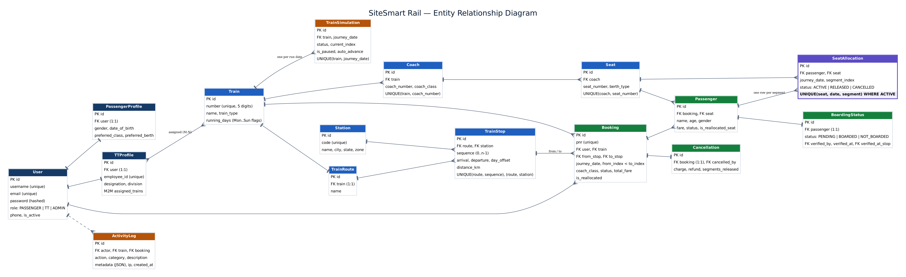

# Database schema

SQLite via the Django ORM. Every model except `User` and `ActivityLog` inherits
`created_at` / `updated_at` timestamps from `apps.core.models.TimeStampedModel`.

(Graphviz source: [`diagrams/er_diagram.dot`](diagrams/er_diagram.dot); SVG: [`er_diagram.svg`](diagrams/er_diagram.svg).)

## Accounts (`apps.accounts`)

### User — `accounts_user` (custom `AbstractUser`)
| Field | Type | Notes |
|-------|------|-------|
| id | BigAutoField | PK |
| username | varchar(150) | unique |
| email | varchar | **unique**, stored lower-case |
| password | varchar | PBKDF2 hash (Django default) |
| first_name, last_name | varchar | |
| role | varchar(12) | `PASSENGER` \| `TT` \| `ADMIN`, indexed |
| phone | varchar(10) | optional, validated Indian mobile |
| is_active, is_staff, is_superuser, date_joined, last_login | | Django standard; ADMIN ⇒ `is_staff` |

### PassengerProfile — 1:1 with User
`user` (OneToOne, CASCADE), `date_of_birth` (nullable), `gender`, `address`, `city`, `state`,
`preferred_class`, `preferred_berth`. Created automatically for passengers (post-save signal).

### TTProfile — 1:1 with User
`user` (OneToOne), `employee_id` (**unique**, `^[A-Z0-9-]{4,12}$`), `designation`
(`TTE`/`SR_TTE`/`CTI`), `division`, `assigned_trains` (**ManyToMany → Train**), `is_on_duty`.

## Railway network (`apps.railway`)

### Station
`code` (**unique**, 2–5 uppercase letters), `name`, `city`, `state`, `zone`, `is_active`.
Indexes on `name`, `city`.

### Train
`number` (**unique**, 5 digits), `name`, `train_type`, `running_days` (7 × `0/1`, Monday
first, at least one `1`), `is_active`, `description`.

### TrainRoute
`train` (OneToOne, CASCADE), `name`. The ordered stops live in `TrainStop`.

### TrainStop
| Field | Notes |
|-------|-------|
| route | FK TrainRoute, CASCADE |
| station | FK Station, **PROTECT** |
| sequence | 0-based index on the route — *defines segment numbers* |
| arrival_time / departure_time | nullable (origin has no arrival, terminus no departure) |
| day_offset | days after the run date |
| distance_km | cumulative from origin; used for fares |
| platform | optional |

Constraints: **UNIQUE(route, sequence)**, **UNIQUE(route, station)**. Index (station, route).

### Coach
`train` (FK, CASCADE), `coach_number` (e.g. S1, B2), `coach_class` (`1A 2A 3A SL CC 2S`),
`position`, `is_active`. **UNIQUE(train, coach_number)**; index (train, coach_class).

### Seat
`coach` (FK, CASCADE), `seat_number` (≥ 1), `berth_type` (`LB MB UB SL SU WS MS AS`),
`is_active`. **UNIQUE(coach, seat_number)**; index (coach, is_active).

## Bookings (`apps.bookings`)

### Booking
| Field | Notes |
|-------|-------|
| pnr | **unique** 10-digit string |
| user | FK User (booked by) |
| train | FK Train, PROTECT |
| journey_date | run date (origin departure), indexed |
| from_stop / to_stop | FK TrainStop, PROTECT |
| from_index / to_index | stop indices at booking time; **CHECK from_index < to_index** |
| coach_class | travel class |
| status | `CONFIRMED` \| `CANCELLED`, indexed |
| passenger_count | 1–6 |
| total_fare | decimal |
| contact_email / contact_phone | |
| is_reallocated | true if any seat came from segments released by a no-show |

Indexes: (train, journey_date), (user, journey_date).

### Passenger
`booking` (FK, CASCADE), `name`, `age` (1–120), `gender`, `berth_preference`,
`seat` (FK Seat, PROTECT), `fare`, `status` (`CONFIRMED`/`CANCELLED`), `is_reallocated_seat`.
Index (seat, status).

### SeatAllocation — the heart of the engine
| Field | Notes |
|-------|-------|
| passenger | FK Passenger, CASCADE |
| seat | FK Seat, PROTECT |
| journey_date | run date |
| segment_index | one row per segment travelled |
| status | `ACTIVE` \| `RELEASED` (no-show) \| `CANCELLED` |
| released_at | when the row stopped being ACTIVE |

**Partial unique constraint `uniq_active_seat_segment`: UNIQUE(seat, journey_date,
segment_index) WHERE status = 'ACTIVE'.** Indexes (seat, journey_date, status) and
(journey_date, status).

### BoardingStatus — 1:1 with Passenger
`status` (`PENDING`/`BOARDED`/`NOT_BOARDED`, indexed), `verified_by` (FK User, SET NULL),
`verified_at`, `verified_at_stop` (FK TrainStop, SET NULL), `remarks`.

### Cancellation — 1:1 with Booking
`cancelled_by` (FK User), `reason`, `cancellation_charge`, `refund_amount`, `segments_released`.

## Operations (`apps.operations`)

### TrainSimulation — one row per run
`train` (FK), `journey_date`, `status` (`SCHEDULED`/`AT_STATION`/`IN_TRANSIT`/`COMPLETED`),
`current_index`, `is_paused`, `auto_advance`, `step_interval_seconds`, `started_at`,
`completed_at`, `last_moved_at`, `last_moved_by`. **UNIQUE(train, journey_date)**.

### ActivityLog
`actor` (FK User, nullable), `action` (17 choices), `category` (AUTH, BOOKING, BOARDING,
REALLOCATION, SIMULATION, ADMIN), `description`, `train`, `booking`, `metadata` (JSON),
`ip_address`, `created_at` (indexed).

## Relationship summary

| From | To | Cardinality | On delete |
|------|----|-------------|-----------|
| User | PassengerProfile / TTProfile | 1 : 0..1 | CASCADE |
| TTProfile | Train | M : N | — |
| Train | TrainRoute | 1 : 1 | CASCADE |
| TrainRoute | TrainStop | 1 : N | CASCADE |
| Station | TrainStop | 1 : N | PROTECT |
| Train | Coach → Seat | 1 : N : N | CASCADE |
| User / Train | Booking | 1 : N | CASCADE / PROTECT |
| Booking | Passenger | 1 : N | CASCADE |
| Passenger | SeatAllocation | 1 : N (one per segment) | CASCADE |
| Seat | SeatAllocation, Passenger | 1 : N | PROTECT |
| Passenger | BoardingStatus | 1 : 1 | CASCADE |
| Booking | Cancellation | 1 : 0..1 | CASCADE |
| Train | TrainSimulation | 1 : N (one per date) | CASCADE |

`PROTECT` on seats, stops and trains means booking history can never be orphaned: such
objects must be deactivated rather than deleted (the admin portal explains this).
